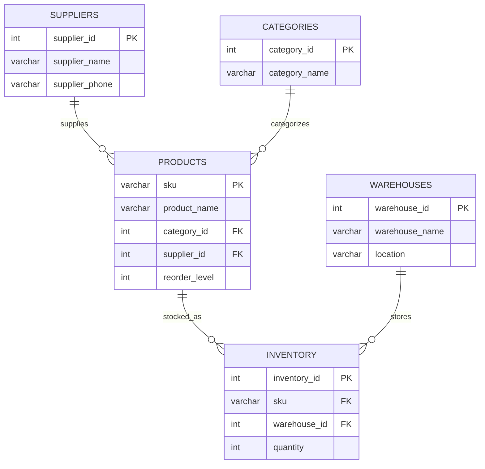

# ER Diagram - Retail Inventory (Set 1)

- **Cardinalities:** One supplier/category supplies/categorizes many products; one product can appear in many warehouse inventory rows; each inventory row belongs to one product and one warehouse.
- **Referential actions:** `ON DELETE RESTRICT` prevents removing referenced parents; `ON UPDATE CASCADE` propagates key changes.
