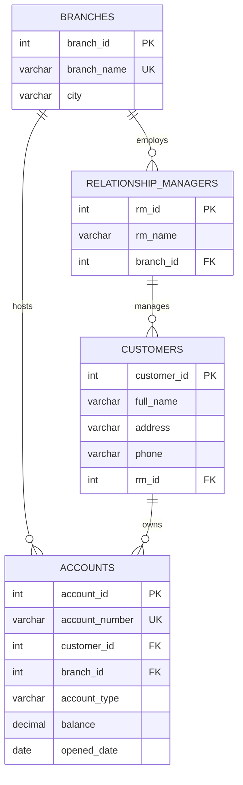

# ER Diagram - Bank Branch Accounts (Set 2)

## Data type justification
- **`DECIMAL(14,2)` for `balance`:** Exact fixed-point arithmetic required for money; avoids binary floating-point rounding errors of `FLOAT/DOUBLE`.
- **`INT AUTO_INCREMENT` for surrogate keys:** Compact, efficient joins and stable identifiers.
- **`VARCHAR` for names/addresses/phone/account_number:** Variable-length text; account numbers kept as strings to preserve leading zeros/format if needed.
- **`DATE` for `opened_date`:** Stores calendar date without time/zone ambiguity for account opening.
- **`CHECK` constraints:** Enforce `balance >= 0` and allowed `account_type` values at the database layer.
